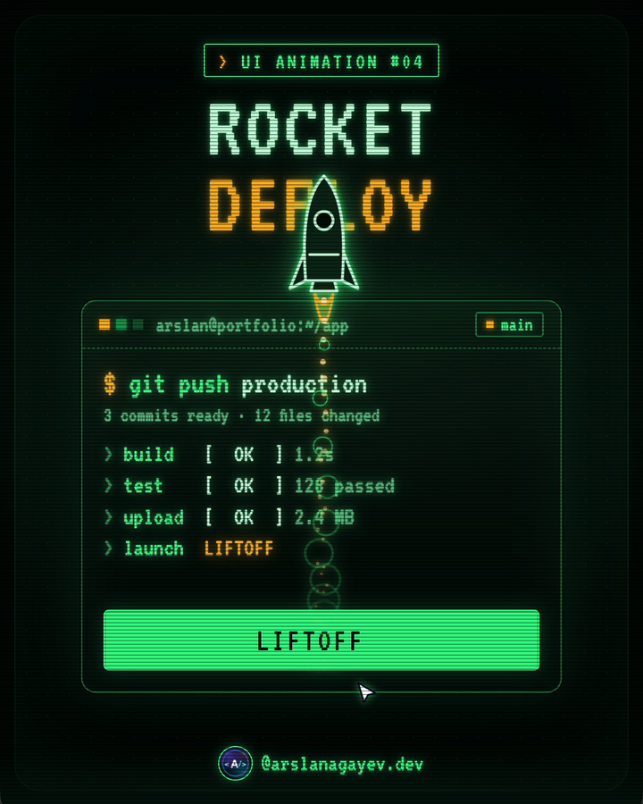

# Rocket Deploy Button

A retro CRT terminal deploy button: build, test and upload logs stream in, the button counts down **T-3, T-2, T-1**, and a vector-display rocket is drawn stroke by stroke, ignites and lifts off out of the window.



**[Live demo](https://arslanagayev.github.io/deploy-button-animation/)** · **[Reel mode](https://arslanagayev.github.io/deploy-button-animation/?reel)** · UI animation #04 of a weekly series on Instagram [@arslanagayev.dev](https://www.instagram.com/arslanagayev.dev/)

Plain **HTML, CSS and JavaScript**: no frameworks, no build step, no dependencies. Click **Deploy**, then click **Live** to deploy again.

## How it works

1. Each pipeline step types its name into the log, shows a `| / - \` spinner (or an ASCII progress bar for the upload) and finishes with `[  OK  ]`.
2. The button fills left to right in **inverse video**: a second copy of the label sits in a green layer that is revealed with `clip-path`.
3. After the countdown the rocket's outline is **drawn stroke by stroke** (`stroke-dashoffset`), like an old vector display.
4. Ignition: the flame flickers, smoke rings roll over the pad and the card shakes.
5. Liftoff: the rocket accelerates with `distance * t^2.6` in a `requestAnimationFrame` loop, the flame grows with speed and it leaves a trail of sparks and smoke. A bloom flash marks the deploy as **Live**.

## Features

- CRT look without images: phosphor bloom with layered `text-shadow`, scanlines from a `repeating-linear-gradient`, a rolling refresh band in reel mode. Fonts: VT323 + IBM Plex Mono
- Vector rocket in inline SVG, glowing with stacked `drop-shadow` filters
- Real `<button>` and an `aria-live` log; `prefers-reduced-motion` skips the typing and the launch

## The key code

```js
// Liftoff: accelerate up, leave an exhaust trail
const tick = (now) => {
  const t = Math.min(1, (now - start) / duration);
  const dy = distance * t ** 2.6;   // feels like thrust
  rocket.style.transform = `translate(${x}px, ${y - dy}px)`;
  if (t < 0.9) spark(x + 40, y - dy + 124);
  if (t < 1) requestAnimationFrame(tick);
};
requestAnimationFrame(tick);
```

## Use it in your project

Copy `index.html`, `style.css` and `script.js`. The component itself has no dependencies; the `reel/` folder is only used by the reel mode described below. To drop it, delete the `mountReel(...)` call at the end of `script.js` and its import on the first line (keep `sleep`: `const sleep = (ms) => new Promise((r) => setTimeout(r, ms));`).

## Reel mode

Add `?reel` to the URL and the page becomes a self-playing 1080×1920 video stage: a title, the animation driven by a scripted cursor, a code excerpt and an end card, on a loop. Open it on a phone and use the built-in screen recorder to get an Instagram reel. `?autoplay` loops the scripted demo without the frame.

Options:

- `?reel&ratio=4x5`: a 1080×1350 stage for Instagram carousel videos
- `?reel&nocode`: hide the code excerpt
- `?reel&delay=3000`: wait 3 seconds before the first run (time to start the recorder)

## Run locally

ES modules don't load from `file://`, so serve the folder:

```bash
git clone https://github.com/arslanagayev/deploy-button-animation.git
cd deploy-button-animation
python3 -m http.server 8080   # then open http://localhost:8080
```

## License

[MIT](LICENSE) © 2026 Arslan Agayev
